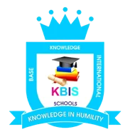
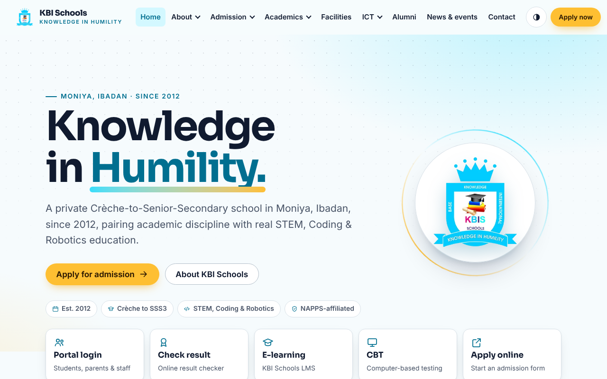

<div align="center">



# Knowledge Base International Schools

**Knowledge in Humility.** Crèche to Senior Secondary education in Moniya, Ibadan.

[](https://github.com/kbischool/kbischool.github.io/actions/workflows/deploy.yml)
[](https://github.com/kbischool/kbischool.github.io/actions/workflows/codeql.yml)

[Live site](https://kbischool.github.io/) · [Docs](docs/) · [Report an issue](https://github.com/kbischool/kbischool.github.io/issues)

</div>

<picture>
  <source media="(prefers-color-scheme: dark)" srcset="docs/assets/preview-dark.png">
  
</picture>

## About

The public website of Knowledge Base International Schools (KBI Schools), a private school founded in 2012 and affiliated with NAPPS, serving pupils from Crèche through SSS3. It gives families the school's story, sections, facilities, STEM and coding programme and news, with a direct route to admission and the school's student portals.

## Features

- Pages for About, Admission, Academics, Facilities, ICT, Alumni, News & Events and Contact
- Quick links to the portal login, result checker, e-learning, CBT and online application
- Admission and contact forms with inline validation that deliver to the school's email
- Installable on Android and iPhone, with an offline page and an in-page "update ready" prompt
- Light and dark themes that follow the device and remember the visitor's choice
- Mobile-first layout, keyboard-friendly navigation, reduced-motion support and print styles
- Self-hosted fonts and no third-party scripts; the map loads only when requested

## How to use it

Browse the site at [kbischool.github.io](https://kbischool.github.io/). Use **Apply now** to start an admission, or **Contact** to message the school. On a phone, use your browser's menu to add it to your home screen.

## Tech stack

Hand-written semantic HTML, CSS and a small amount of JavaScript. A zero-dependency Node build script assembles the pages from templates. Fonts: Sora and Inter via Fontsource (SIL Open Font License), self-hosted. Hosted on GitHub Pages and deployed by GitHub Actions. Forms use [FormSubmit](https://formsubmit.co/).

## Project structure

```
src/pages/            One file per page (content)
src/layout.html       Shared header, footer and head tags
src/assets/css/       tokens.css (design tokens) and main.css (components)
src/assets/js/        theme.js (runs before paint) and main.js
src/assets/img/       Crest, icons, social image, install screenshots
src/public/           Files copied to the site root (favicons)
src/sw.template.js    Service worker template
scripts/              build.mjs and check.mjs
docs/                 Owner and maintainer guides
.github/workflows/    Deploy, pull request check and CodeQL
```

## Contributing

Spotted a mistake or have an idea? [Open an issue](https://github.com/kbischool/kbischool.github.io/issues/new). Developers: see [CONTRIBUTING.md](CONTRIBUTING.md).

## Security

See [SECURITY.md](SECURITY.md) to report a vulnerability.

## Credits

Crest and school content belong to Knowledge Base International Schools. Fonts: [Sora](https://fontsource.org/fonts/sora) and [Inter](https://fontsource.org/fonts/inter), SIL Open Font License 1.1. Icons are original line drawings made for this site.

Built by [Babatunde Awoyemi](https://github.com/babatundeawo) / Techbase Consultant Services.
